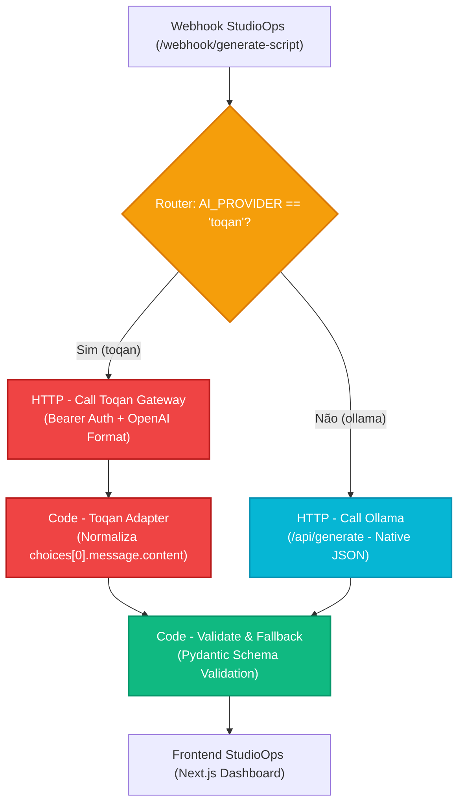

# 🔌 Guia de Integração: Toqan AI Gateway (iFood)

Este documento descreve a arquitetura da camada de abstração (**Toqan Adapter Layer**) do **StudioOps**, detalhando como alternar perfeitamente entre o motor local de IA (**Ollama**) e o gateway corporativo de GenAI do iFood (**Toqan**), garantindo **zero impacto** no frontend e máxima resiliência operacional.

---

## 1. Visão Geral da Arquitetura Dual

O StudioOps foi projetado com uma arquitetura desacoplada e modular baseada no padrão **Adapter / Strategy**:

| Provedor | Cenário de Uso | Custo | Dependência de Rede | Modelo Padrão |
| :--- | :--- | :--- | :--- | :--- |
| **Ollama** | Desenvolvimento local, testes offline, demonstrações e contingência | R$ 0,00 | Totalmente Offline (Localhost) | `llama3.2:3b` / `llama3:8b` |
| **Toqan** | Produção corporativa, alta fidelidade criativa, SEO avançado | Enterprise (iFood) | Requer VPN corporativa iFood | `claude-3-5-sonnet` / `gpt-4o` |

### Diagrama de Roteamento no n8n



---

## 2. Variáveis de Ambiente

Para alternar o provedor de IA ou configurar as credenciais do Toqan, configure as seguintes variáveis no arquivo `.env` do seu ambiente (ou nas variáveis de ambiente do n8n / Docker):

```ini
# ==============================================================================
# SELEÇÃO DO PROVEDOR DE INTELIGÊNCIA ARTIFICIAL
# Valores permitidos: "ollama" (padrão local) | "toqan" (gateway iFood)
# ==============================================================================
AI_PROVIDER=toqan

# ==============================================================================
# CONFIGURAÇÃO DO TOQAN GATEWAY (iFood Enterprise)
# ==============================================================================
TOQAN_API_URL=https://toqan-gateway.internal.ifood.com.br/v1
TOQAN_API_KEY=seu-token-bearer-gerado-no-portal-toqan
TOQAN_MODEL=claude-3-5-sonnet

# ==============================================================================
# CONFIGURAÇÃO DO OLLAMA LOCAL (Fallback & Desenvolvimento)
# ==============================================================================
OLLAMA_HOST=http://127.0.0.1:11434
OLLAMA_MODEL=llama3.2:3b
```

---

## 3. Mapeamento de Payloads (De / Para)

O Toqan Gateway opera segundo a especificação compatível com OpenAI Chat Completions (`/v1/chat/completions`). O adaptador converte os dados automaticamente:

### 3.1. Envio (Request)

| Campo StudioOps | Formato Ollama (`/api/generate`) | Formato Toqan (`/v1/chat/completions`) |
| :--- | :--- | :--- |
| **Model** | `"model": "llama3.2:3b"` | `"model": "claude-3-5-sonnet"` |
| **System Prompt** | `"system": "Você é o Roteirista..."` | `messages: [{"role": "system", "content": "Você é o Roteirista..."}]` |
| **User Prompt** | `"prompt": "Tema: IA para vídeos..."` | `messages: [..., {"role": "user", "content": "Tema: IA para vídeos..."}]` |
| **JSON Mode** | `"format": "json"` | `"response_format": {"type": "json_object"}` |
| **Temperatura** | `"options": {"temperature": 0.7}` | `"temperature": 0.7` |

### 3.2. Resposta (Response)

O **Code - Toqan Adapter** extrai a resposta crua e encapsula no campo padrão `response`, de modo que todos os nós seguintes consumam exatamente a mesma chave:

```javascript
// Nó: Code - Toqan Adapter
const item = $input.first().json;
let rawContent = '';

if (item.choices && item.choices.length > 0 && item.choices[0].message) {
  rawContent = item.choices[0].message.content;
} else if (item.response) {
  rawContent = item.response;
} else {
  rawContent = JSON.stringify(item);
}

return [{
  json: {
    source: 'toqan',
    provider: 'toqan-gateway',
    response: rawContent
  }
}];
```

---

## 4. Guia Passo a Passo para Transição (Quando você tiver o acesso)

Assim que você receber as credenciais corporativas do Toqan e acesso à VPN do iFood, siga os passos abaixo para ativar o gateway em menos de 2 minutos:

### Passo 1: Conectar à VPN Corporativa
Certifique-se de que o seu client de VPN corporativa (ex: Zscaler, GlobalProtect ou AWS Client VPN) esteja ativo e conectado.
> **Dica de validação:** Teste no terminal se o endpoint interno resolve:
> ```powershell
> Test-NetConnection -ComputerName toqan-gateway.internal.ifood.com.br -Port 443
> ```

### Passo 2: Configurar o Token do Toqan no n8n
1. Se estiver rodando o n8n via Docker ou terminal local, adicione as variáveis no seu `.env`:
   ```env
   AI_PROVIDER=toqan
   TOQAN_API_URL=https://toqan-gateway.internal.ifood.com.br/v1
   TOQAN_API_KEY=toqan_prd_xxxxxxxxxxxxxxxxxxxxxx
   TOQAN_MODEL=claude-3-5-sonnet
   ```
2. Se estiver rodando o n8n no modo desktop/npm:
   ```powershell
   $env:AI_PROVIDER="toqan"
   $env:TOQAN_API_URL="https://toqan-gateway.internal.ifood.com.br/v1"
   $env:TOQAN_API_KEY="toqan_prd_xxxxxxxxxxxxxxxxxxxxxx"
   $env:TOQAN_MODEL="claude-3-5-sonnet"
   ```

### Passo 3: Importar ou Atualizar os Workflows no n8n
Os workflows na pasta `orchestration/workflows/` já contam com o nó de roteamento integrado:
- `studio_ops_master_workflow.json` (Orquestrador Master completo)
- `01_trends_workflow.json` (Coolhunter)
- `02_generate_script_workflow.json` (Roteirista + Growth Hacker)
- `04_metrics_insights_workflow.json` (Performance Analyzer)

Importe o JSON desejado no painel do n8n (**Workflows** ➔ **Import from File**) e clique em **Save** e **Active**.

### Passo 4: Executar a Bateria de Testes Automatizada
Execute o script de testes para validar a comunicação e os schemas Pydantic:
```bash
python orchestration/scripts/test_toqan_adapter.py
```
O teste valida automaticamente:
1. Health check do gateway com autenticação Bearer
2. Coolhunter Agent (schema de tendências)
3. Roteirista Agent (3 cenas, 15 segundos, prompts 9:16)
4. Growth Hacker Agent (título SEO, descrição e hashtags)
5. Performance Analyzer Agent (diagnóstico e métricas)
6. Tratamento de token inválido (401)
7. Alternância dinâmica de provedor sem impacto no frontend

### Passo 5: Testar no Dashboard Frontend
1. Abra o frontend do StudioOps em `http://localhost:3000`.
2. Acesse a aba **Tendências do Dia** e clique em **Atualizar Tendências**.
3. Acesse o **Estúdio de Criação** e gere um vídeo.
4. Note que o conteúdo agora é alimentado diretamente pelo modelo corporativo configurado no Toqan (ex: Claude 3.5 Sonnet), mantendo toda a interface, player de vídeo e botões de cópia 100% idênticos!

---

## 5. Resiliência e Política de Fallback

Para garantir que o estúdio nunca pare mesmo se a VPN do iFood oscilar ou desconectar:

1. **Continue on Fail**: Todos os nós HTTP do Toqan no n8n estão configurados com `continueOnFail: true`.
2. **Camada de Sanitização**: Se o Toqan retornar erro HTTP (401, 403, 500, timeout ou falha de DNS da VPN), o nó `Code - Validate & Fallback` detecta a ausência de resposta válida e ativa instantaneamente os ganchos e roteiros de contingência de alta conversão.
3. **Resilient AI Client (Python)**: Na camada Python, o `ResilientAIClient` captura automaticamente exceções `ToqanConnectionError` ou `ToqanAuthError` e faz fallback automático para o Ollama local quando `enable_fallback=True`.

---

## 6. Teste com Mock Local (Sem VPN)

Você pode testar e homologar todo o comportamento do Toqan sem precisar estar na VPN do iFood utilizando o mock server embutido:

```bash
# Executa a suite com mock server integrado na porta 8001
python orchestration/scripts/test_toqan_adapter.py
```

Para usar o mock server com o n8n ou o frontend em modo de teste:
```ini
AI_PROVIDER=toqan
TOQAN_API_URL=http://127.0.0.1:8001/v1
TOQAN_API_KEY=mock-toqan-ifood-secret-token-777
TOQAN_MODEL=claude-3-5-sonnet
```

---

## 7. Troubleshooting Comum

| Sintoma | Causa Mais Provável | Solução |
| :--- | :--- | :--- |
| **HTTP 401 Unauthorized** | Token expirado ou digitado incorretamente | Verifique a variável `TOQAN_API_KEY` e renove o token no portal do Toqan. |
| **Connection Refused / EHOSTUNREACH** | VPN do iFood não está conectada | Conecte o Zscaler/VPN corporativa ou mude `AI_PROVIDER=ollama`. |
| **JSON Parse Error** | O modelo retornou texto livre sem JSON | O nó de validação ativa automaticamente o fallback de resiliência. Certifique-se de que o modelo suporta `response_format: {"type": "json_object"}`. |
| **Timeout (>45s)** | Fila de inferência corporativa congestionada | O timeout do nó HTTP no n8n foi configurado para 45s. Se necessário, aumente para 60s nas opções do nó. |
